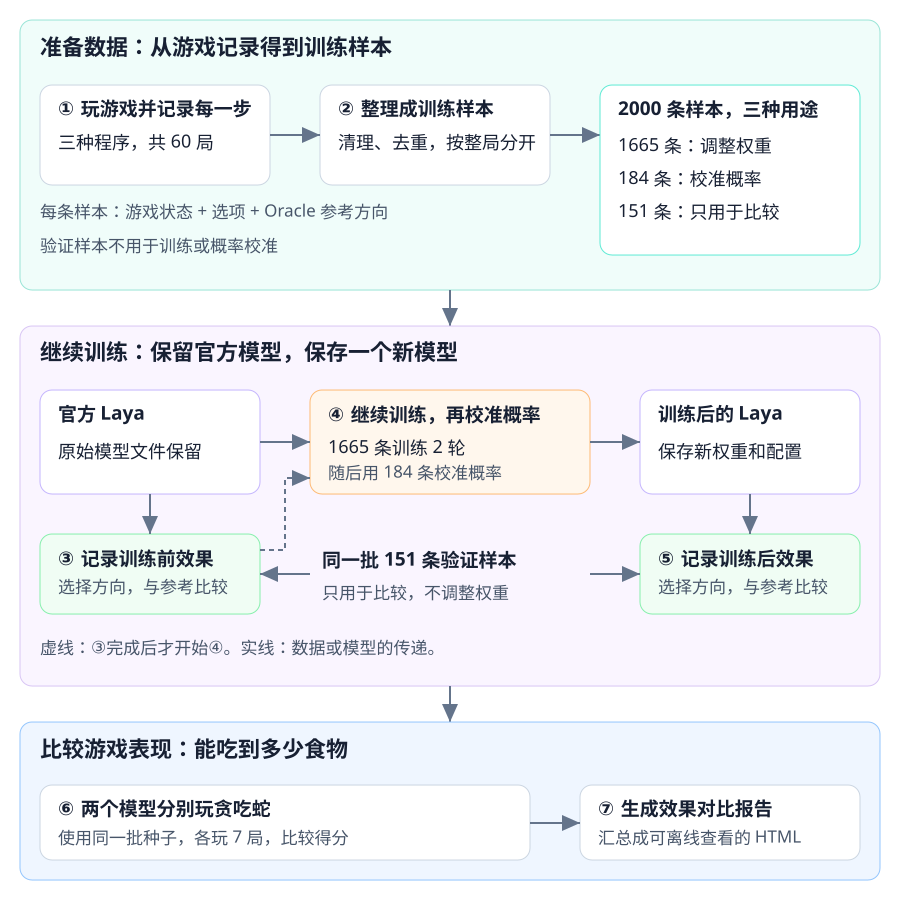
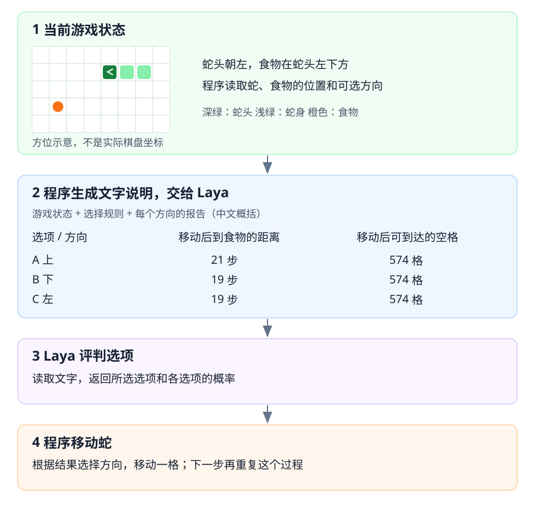
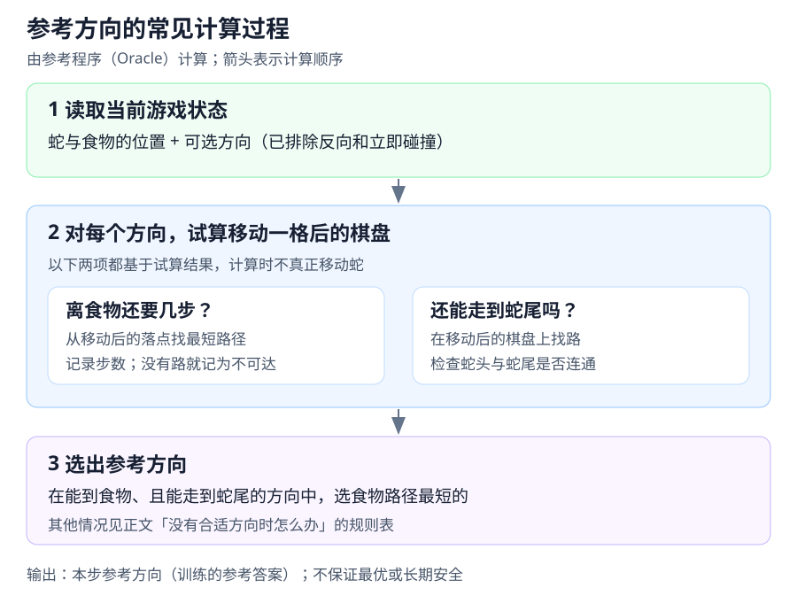
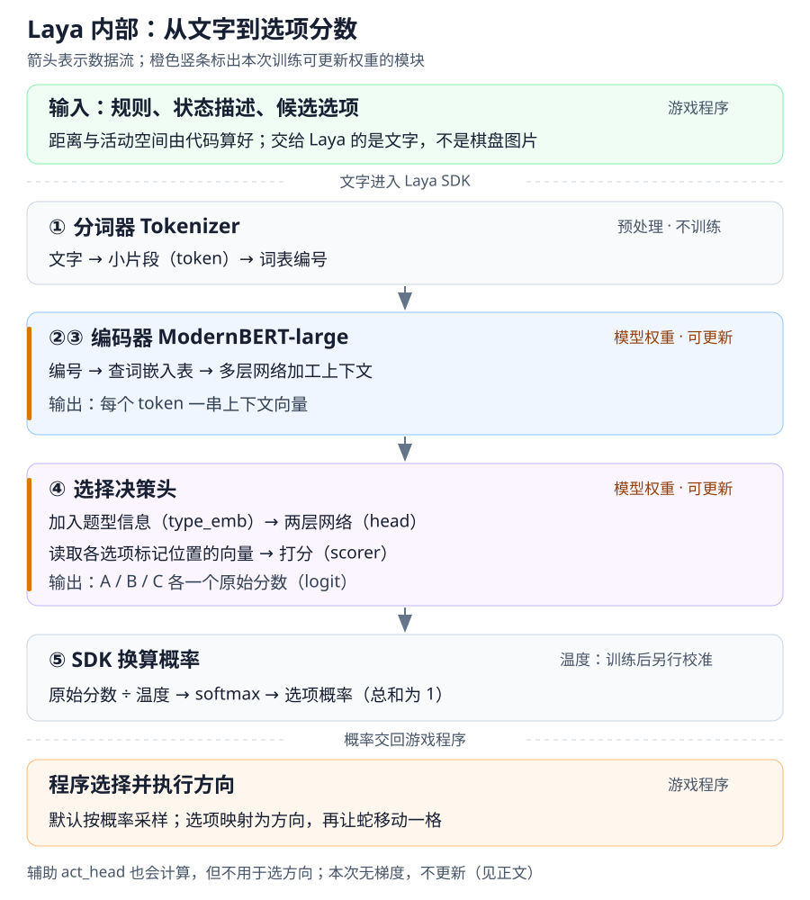
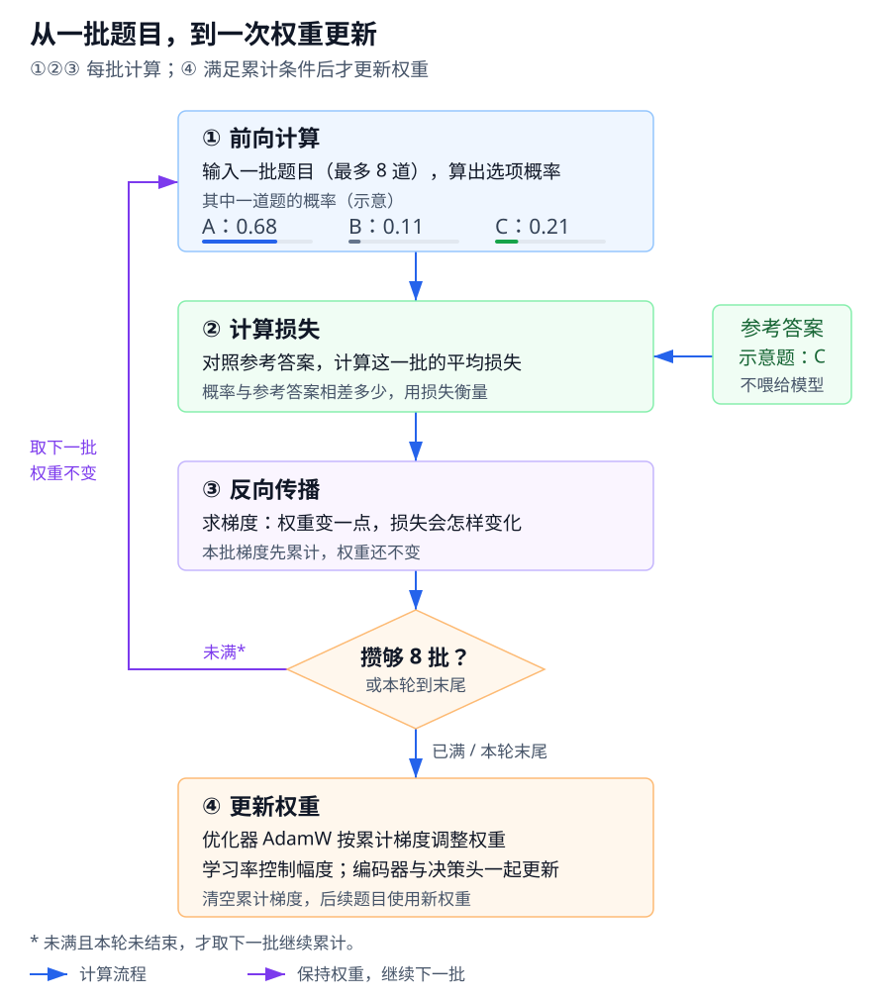
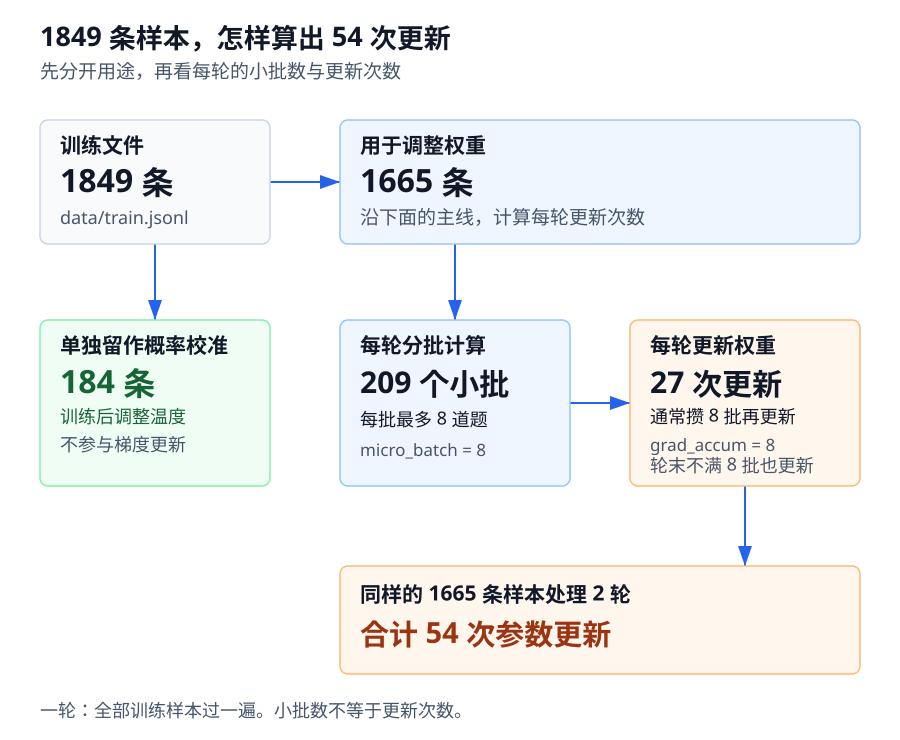
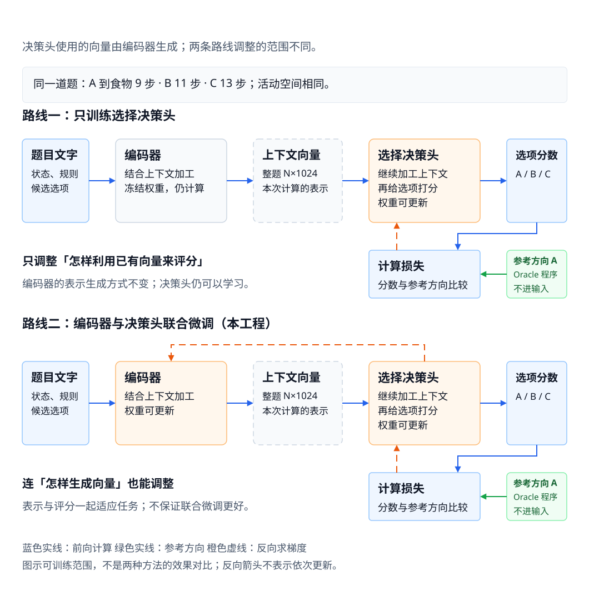

读这篇不需要机器学习基础。我们用贪吃蛇做一次训练实验，重点是看懂模型收到什么、训练怎样改变它，再判断这些变化有没有帮助。

Laya 是一个决策模型：根据给定的信息和任务说明，进行选择、评分或判断，并返回结构化结果。

在本工程里，我们把游戏状态和各个方向的报告写成文字，让它评判移动选项，再由程序控制蛇移动。

这里采用**有监督训练**：给每条输入配上参考答案，用它衡量模型预测的误差，再调整模型权重。参考移动方向由名为 Oracle 的程序按路径和安全规则计算，不是保证最优的答案。

我们从下载的官方模型继续训练，而不是从零训练。「官方版」指原始模型，「微调版」指这次训练后另存的新模型。

这篇讲实验设计、输入文本、模型内部和训练机制。同一系列还有《操作篇》（运行命令与产物）和《证据篇》（实际效果与限制），**这两篇会作为后续文章陆续发出**，本篇不依赖它们也能读完。模型结构中更细的公式和实现，仍放在可跳过的小节里。

## 先认识几个词

后面会反复出现，先打个底，不用记死：

| 词 | 这篇文章里的意思 |
|---|---|
| **模型 / 权重** | 模型就是一大堆数字（这里约 4.2 亿个），这些数字叫权重。训练就是在改它们 |
| **agent** | 控制蛇移动的程序。random 随机选方向，greedy 优先靠近食物，oracle 按路径和安全规则选方向，laya 用模型给选项打分 |
| **种子（seed）** | 给随机数发生器的初始值。本工程的开局蛇形是固定的，种子决定食物出现在哪儿，所以换种子就会改变游戏中食物出现的位置序列 |
| **loss（损失）** | 衡量预测概率与目标相差多少。越小越贴近目标；给正确答案的概率低，通常损失大 |
| **微调（finetune）** | 不从零开始，而是在一个已有模型上继续训练，让它适应新任务 |
| **checkpoint** | 存盘的模型，一个目录，装着权重和配置。本篇里「微调版」就是一个 checkpoint |
| **Oracle** | 按写好的路径和安全规则计算参考方向的程序，不需要训练，也不保证选出最优方向 |
| **hit_oracle** | 这一步实际选的方向是否与 Oracle 参考方向一致。统计时剔除只剩一个可选方向的步 |
| **训练集 / 验证集** | 训练集用于调整权重（本工程另划出一部分校准概率）；验证集只用于比较效果，不用于训练或概率校准。训练用过的数据不能充当独立验证数据 |
| **泛化** | 在没练过的题上也答得好，才叫学会了。只在练过的题上好，叫过拟合 |

<a id="overview"></a>

## 先看全景

整个过程是：**收集游戏数据 → 用数据继续训练 Laya → 比较训练前后的效果**。这里的“一局”指从开始玩贪吃蛇到游戏结束，“一步”指蛇移动一次。



[放大看 SVG](/assets/laya/laya-learning-pipeline.svg)

从上到下看三层：准备数据、继续训练、比较游戏表现。编号 ①–⑦ 对应《操作篇》第 1–7 步。第二层把两个模型放在左右两侧，方便比较；实际执行时先做③，记录官方模型的效果，再做④训练和概率校准，最后做⑤记录新模型的效果。

### 保存什么数据，参考方向从哪来？

这次让 random / greedy / oracle 各玩 20 局，共 60 局。程序记录每一步蛇和食物的位置，以及这一步能走的方向。这些信息合起来叫**游戏状态**，后文也会称为“局面”。

**Oracle 是本工程里计算参考方向的程序。** 它检查哪些路径能通往食物、走一步后蛇头还能否通向蛇尾，再按[训练数据从哪里来](#reference)的规则选一个方向。它不需要通过训练学会这些规则。它选出的方向用作训练目标，但不是保证最优或永远安全的答案。

每条训练样本包含三部分：**游戏状态、可选方向的文字说明、Oracle 选出的参考方向**。训练时，Laya 先给各选项算出概率，程序再把这些概率与参考方向比较，计算误差并调整权重，让预测更接近参考方向。这就是图中④做的事。

### 三份数据各做什么？

| 用途 | 条数 | 具体操作 |
|---|---:|---|
| 调整模型权重 | 1665 | 重复训练 2 轮，调整模型里用于选择方向的数字（权重） |
| 校准输出概率 | 184 | 作为④的收尾，用这些样本调整概率的高低，不再改模型权重 |
| 比较训练前后的效果 | 151 | 两个模型分别选择方向，统计与 Oracle 参考方向一致的比例；不用它们训练或校准概率 |

前两份合起来是 `data/train.jsonl` 的 1849 条；最后一份是 `data/val.jsonl` 的 151 条。

“校准概率”处理的是模型有多自信。例如，模型给某个方向 90% 的概率，不代表类似选择真的有 90% 与参考方向一致。我们用那 184 条样本调整一个概率缩放参数，尽量减少这种偏差。这个参数的技术名称叫**温度**，与机器发热无关；调整它的过程叫**温度标定**，[Laya 内部长什么样](#architecture)会展开。它不保证模型选方向更准。

### 怎样判断训练有没有效果？

图中③和⑤都不训练模型，只让模型处理同样的 151 条样本，记录结果。图中⑥则让两个模型真的玩贪吃蛇，比较吃到多少食物。这是两种不同的检查：

| 检查方式 | 关注什么 |
|---|---|
| 同样的 151 条验证样本 | 与参考方向是否一致、预测概率与目标相差多少 |
| 两个模型各玩 7 局游戏 | 整局吃到多少食物，怎样结束 |

具体成绩和结论边界放在《证据篇》。

训练完成后，程序把**新权重和配置**保存到 `checkpoints/laya-snake-v1/`。官方模型的原始文件不覆盖，两个模型可以分别加载。

文中的样本条数和训练配置来自这次历史实验，对应 `data/stats.json` 与 `checkpoints/laya-snake-v1/train_report.json`。它们用来串起过程，不是承诺重跑会得到相同数字。

**结果还有限制：**训练数据使用种子 1001–1020，游戏比较使用 1001–1007，范围重合。因此这组得分不能证明模型在新种子上也能玩好。151 条验证样本按整局游戏留出，也不能替代独立新种子的游戏检验。《证据篇》·结果，以及三条限制会展开。

这一版到报告为止，没有读完报告后自动收集新样本、再训练的步骤。

<a id="experiment"></a>

## 1. 贪吃蛇实验在做什么

贪吃蛇的规则不用多说。本实验用 24×24 的格子，撞墙或撞自己就结束。吃到一格食物加 1 分，所以后文说的「分数」就是这一局吃掉的食物数。还有一条防赖规则：连续 576 步没吃到东西判饿死（`--starve-limit`，默认跟棋盘格子数一样）。

特别的地方在于**模型不负责规划路线**。

每走一步，程序先干两件事。先把「走过去立刻就死」的方向划掉，只留下还能活的。然后给每个活着的方向写一份简短报告：落点在哪、从那儿到食物还要几步、走完还剩多少格子能动。

模型拿到的就是一道选择题：一段固定的答题规则，加上几个带报告的选项。多数时候三选一，有时只有两个方向活着。挑一个，程序照着走，再来一遍。

这张图展示蛇移动一次时，游戏程序和 Laya 分别做什么。



[放大看 SVG](/assets/laya/laya-decision-flow.svg)

**模型看到的是文字，不是这张棋盘图片。** 程序先计算各方向的距离和可活动空间，再把结果写进文字报告。图中只是中文概括，实际输入的英文原文见[训练数据长啥样](#sample)。

选项的 `21 / 19 / 19 步` 和 `574 格` 来自 `data/train.jsonl` 第一条。小棋盘只表示相对方位，不按真实坐标摆放蛇和食物。真实样本里，蛇头在 `(19,14)`，食物在 `(7,22)`：食物在蛇头左侧 12 格、下方 8 格。坐标 x 向右增大，y 向下增大。

**参考答案、模型预测、实际移动是三件事。** 这条样本的参考答案是 `C`，由 Oracle 计算，供训练时比较；它不是模型此次返回的结果，也不作为输入交给模型。Laya 返回所选选项和各选项的概率。程序默认按概率抽取方向，所以实际移动可能与模型选项不同（《证据篇》·同一个局面，训练前后有真实例子）。图中没有展示或编造这条样本的模型预测。

这些报告不是模型算的，是普通代码算的。找路这类事，程序又快又准，神经网络（Laya 就是一个）干不过它。本工程用了两个经典算法：

- **广度优先搜索（BFS）**：从候选方向的落点出发（不是从当前蛇头），一圈一圈向外扩，第一次碰到食物时走过的圈数就是最短距离。
- **洪水填充**：像水从一个格子漫出去，看能淹到多少格。用来判断「走完这一步之后，还剩多大一片连通的活动空间」。

那个 574 就是洪水填充数出来的，不是魔数。棋盘 576 格，这时蛇长 3，但走一步之后尾巴跟着往前挪，真正挡路的只剩 2 节身体，576 − 2 = 574。食物不算障碍，落点自己也算一格。想抠细节看 `snake/agent.py` 的 `flood_fill_size`。这个数后面还会反复出现。

把找路这块拿掉之后，剩下的才是我们真正想观察的：**信息都摆在面前了，模型会不会做出好判断，训练能不能改善这个判断。**

<a id="sample"></a>

## 2. 训练数据长啥样

`data/train.jsonl` 是存放训练数据的文件，一行一个JSON，把它整理成易读的样子就是下面这样。原文是英文，模型的输入：

```text
state.situation: A 24 by 24 grid with solid walls on all four sides. ...
state.snake:     The snake is 3 cell(s) long, heading left, with its head at (x=19, y=14).
state.food:      the food is 8 cell(s) down and 12 cell(s) left from the head

问题类型: choice
答题规则（instructions，每道题都一样，来自 snake/features.py 的 QUESTION）:
  You are steering a snake on a walled grid. Each option is a direction that is
  already safe for this step and comes with a short report ... Choose the option
  that best keeps the snake alive and fed: prefer the fewest steps to the food,
  but never trade so much free space that the snake could get trapped.
  When the reports tie, prefer more free space.

选项 A: move up   to (x=19, y=13); from there a clear 21-step path reaches the food; leaves 574 free cell(s)
选项 B: move down to (x=19, y=15); from there a clear 19-step path reaches the food; leaves 574 free cell(s)
选项 C: move left to (x=18, y=14); from there a clear 19-step path reaches the food; leaves 574 free cell(s)

期望答案: C
```

规则那段是人写死的，每道题一字不改，中文意思是：**优先选离食物步数少的；但别为了少走两步把自己困死；两个选项打平时，选剩余空间大的那个。** 策略不用模型自己发明，它写在题面上。模型要练的是把这几句话跟选项里的「19 步」「574 格」对上号，也就是针对贪吃蛇这个场景专门训练，让模型能够真正理解规则。

翻成表更清楚：

| 选项 | 贪吃蛇运行方向 | 落点坐标 | 到食物还要几步 | 走完剩多少格 |
|---|---|---|---|---|
| A | 上 | (19,13) | 21 | 574 |
| B | 下 | (19,15) | **19** | 574 |
| C | 左 | (18,14) | **19** | 574 |

三个方向走完都剩 574 格，安全性没差别。差别只在离食物远近，B 和 C 并列第一。

### 选项为什么叫 A/B/C

如果选项直接叫「上」「下」「左」，模型很可能养成「总选上」这种跟局面无关的习惯。它不需要读内容也能蒙对一部分，那就学不到东西了。

用中性的 A/B/C，再在训练时每轮打乱顺序（配置项 `shuffle_options`），模型就被逼着去读选项里的数字。

顺带区分两个容易混的设置：训练时打乱选项顺序，是训练手段；跑游戏时默认不打乱（`debias=none`），是推理设置。两码事。

### 这道题其实有噪声

B 和 C 的方向、落点不同，但两个关键数字完全一样：都是 19 步到食物，都剩 574 格。题面那条 tie-break 规则（打平选空间大的）在这里也用不上——空间同样是 574。模型能看到的信息里，这两个选项分不出高下。

答案写 C，只是因为 Oracle 在打平时按方向的固定顺序挑了一个。`snake/oracle.py` 先比步数，步数相同比方向向量，顺序是 left < up < down < right，所以 left（C）压过 down（B）。这个顺序跟局面无关，模型没法从题面推出来。Oracle 看得见整张棋盘（[训练数据从哪里来](#reference)会讲），但在这个局面上它也没看出 B、C 有什么差别，只是按固定顺序挑了一个。

这种并列样本对模型来说是纯噪声。两个选项一样好，标签却只认一个，再怎么学也学不出差别来。

这里有个上限：题面和选项报告里写了什么，决定了模型最多能学到什么。报告里没有的信息，再训也学不到。想突破它，得去改 `snake/features.py` 里报告的内容，训练解决不了。

<a id="reference"></a>

## 3. 训练数据从哪里来？

如何获取训练样本里的“正确答案？。我们使用固定规则的程序选方向：获取蛇和食物的位置，寻找运行路径，选出一个参考方向。
这个程序叫 **Oracle**；下文叫它「参考程序」。它不用训练，规则写在 `snake/oracle.py` 里。
另一个是 **greedy**，下文叫它「追食程序」：有路到食物就选最短的，没路才选可活动空间最大的方向。它用来对比游戏表现；

本实验的训练答案统一由参考程序计算，不照抄追食程序或其他玩家实际走的方向。两者都是按规则运行的程序，Laya 才是我们要训练的模型。

### 参考方向怎样算出来

游戏程序先排除反向、撞墙和撞身体的方向。参考程序对剩下的每个方向，分别试算「如果先移动一格，棋盘会变成什么样」，再比较结果。**试算不会真的移动蛇。**

图里画的是常见情况：能找到通往食物的路，也有方向通过通向蛇尾的检查。其他情况在下面的规则表里。



[放大看 SVG](/assets/laya/laya-oracle-rules.svg)

找食物时，程序从移动后的落点出发，用[贪吃蛇实验在做什么](#experiment)讲的广度优先搜索（BFS）数最短路径的步数。找蛇尾时，程序检查：在这张移动后的棋盘上，蛇头能否沿空格走到蛇尾？后面把这项检查简称为「回尾检查」。

检查通向蛇尾的路，是为了判断蛇头有没有被身体隔开，**不是要求蛇下一步去追尾巴**。蛇在不吃食物的移动中，尾巴也会向前挪一格，腾出旧格子。程序据此把蛇尾格作为可通行的终点，估计有没有通路。这是统一采用的近似：即使试算的这一步吃了食物、尾巴没有挪动，程序也把尾格当作可通行终点。

程序没有模拟整条路径上身体每一步怎样变化。找到这条路只是通过了一项风险检查；后续移动、吃食物和身体增长都会改变棋盘，不能据此保证蛇一直活下去。

### 为什么两个程序会选不同方向

假设只剩下面两个可选方向。数字是讲解示意，不是实验记录；步数都从移动后的落点算起。

| 选项 | 方向 | 到食物的最短路径 | 移动后能否走到蛇尾 |
|---|---|---|---|
| A | 上 | 5 步 | 不能 |
| B | 右 | 7 步 | 能 |

追食程序（greedy）选 A，因为 5 步更近。参考程序（Oracle）选 B，因为它先在能到食物的方向中找通过回尾检查的，再比较距离。

追食程序也会绕开障碍找路，不是看着食物的方位盲走。两者在这里的差别，是有没有多做回尾检查。

### 没有合适方向时怎么办

参考程序从第 1 条开始判断，**满足哪一条就选方向并停止**。表里的「能到食物」指在试算后的棋盘上找到路径，不保证照着走就一定吃到。

| 顺序 | 当前情况 | 怎样选参考方向 | 日志里的理由 |
|---|---|---|---|
| 1 | 能到食物的方向中，至少一个通过回尾检查 | 在这些方向中选食物路径最短的 | `chase_safe` |
| 2 | 有方向能到食物，但这些方向全没通过回尾检查 | 仍选能到食物、路径最短的方向 | `chase_unsafe` |
| 3 | 所有方向都找不到食物路径，但有方向通过回尾检查 | 在通过检查的方向中选可活动空间最大的 | `survive_safe` |
| 4 | 所有方向都找不到食物路径，也都没通过回尾检查 | 在全部可选方向中选可活动空间最大的 | `survive` |

第 2 条容易被误读。即使另一个方向通过了回尾检查，只要它到不了食物，参考程序仍会选没通过检查的追食方向。它有时会冒险追食，参考答案也会继承这个选择。路径距离或空间打平时，程序按固定方向顺序选一个；[训练数据长啥样](#sample)的 B/C 并列样本就是例子。

### 算出的方向怎样变成训练数据

看一条真实记录：`benchmarks/logs/baseline/random.jsonl` 的第 8 局、第 239 步，也就是[训练数据长啥样](#sample)样本的来源。当时控制蛇的是随机程序（random），它实际选择了「下」；参考程序计算出的方向却是「左」。

| 游戏记录里的信息 | 整理成训练样本时怎么用 |
|---|---|
| 当时的游戏状态、各方向的文字报告 | 保留为 `state` 和 `questions`，交给 Laya |
| 实际走了「下」（`chosen=down`） | 留在游戏记录里，不作为本样本的参考答案 |
| 参考程序选「左」（`oracle_direction=left`） | 对照选项表，「左」对应 C，写入 `expected.move=C` |

这样，一条游戏记录就成了「文字输入 + 参考答案」的一对数据。有监督训练用这个参考答案比较模型预测、计算误差，再调整权重；**参考答案不作为输入交给模型**。只有一条可走方向、无需选择的步骤会被剔除，其余数据清理见《操作篇》·整理训练样本。

这次的数据来自随机、追食和参考三个程序各玩 20 局后的记录；清理并按采样上限选取后，共得到 2000 条样本，再分为训练和验证两部分（`data/stats.json`）。程序能逐步计算参考方向，我们就不必请人给每一步标答案。

参考程序的历史实测平均分是 116.86（种子 1001–1007，共 7 局），20 局时是 107.90，分别见 `benchmarks/baseline-fast-7.json` 和 `benchmarks/baseline-fast.json`。这些分数说明它在本次实验中的表现，不是理论上限。

我们让 Laya 学着接近这套参考选择，这种学习其他策略行为的做法叫「模仿学习」。但参考程序读完整棋盘，Laya 只读文字报告；当前报告没有直接写出能否通过回尾检查。训练不会凭空补齐缺失的信息，也不保证 Laya 比参考程序更强。

> 术语补充：这里的参考来自规则程序，不是另一个模型给出的概率，因此不用「知识蒸馏」来称呼这次训练。

<a id="architecture"></a>

## 4. Laya 内部长什么样

Laya 是一个文本决策模型：读取状态、问题和候选选项，输出结构化结果。本工程使用它的 `choice`（多选一）能力选择移动方向。

它的主体是**文本编码器 + 决策头**。编码器把文字加工成带上下文的向量，决策头利用这些向量给选项打分。所有选项一起进入网络，不像聊天模型那样逐字生成回答。

### 先看整台机器

图里的编号与下方逐层示例对应。先看每一块收到什么、输出什么；名词和数字在示例里展开。



[放大看 SVG](/assets/laya/laya-architecture.svg)

这里有两条边界：**游戏程序先算路径距离、活动空间，再写成文字；Laya 负责评判文字，实际移动仍由游戏程序执行。** Oracle 的参考方向不放进这份输入，只在训练时用于计算损失、在评估时用于比较选择。

从文本进入网络到得到选项分数，这次计算叫**一次前向传播**，下文简称「前向」。编码器到选项打分的通路称为「选择主链」；编码器之后的 `type_emb`、`head`、`scorer` 合称「选择决策头」。图中的橙色标记表示本次训练开放哪些权重更新，不表示推理时也会改权重，更不是模块依次训练的顺序。

### 跟着一道题走一遍

我用《证据篇》·同一个局面，训练前后那道真实题目，摘出方便阅读的部分。实际题面是英文，下面先给中文概括：

```text
题型：choice，从候选选项中选一个。
状态：蛇头 (12,12)，食物正上方 10 格。
规则：优先少步，但别困住；步数一样选空间大。
A：up，到食物 9 步，空间 574
B：right，到食物 11 步，空间 574
C：down，到食物 13 步，空间 574
```

状态、题型、答题规则和选项在 `predict` 接口里分别提供。laya的SDK 先整理、分词，再把整段内容拼成**一个 token 序列，整体交给编码器处理**。状态、规则、选项 使用相同的编码器，也不是各自编码完才拼起来。

拼接顺序跟下面的中文示例一样，进入网络时是一条连续序列：

```text
[CLS] choice question：优先少步，但别困住；步数一样选空间大。
[SEP]
[MASK] A：up，到食物 9 步，空间 574
[MASK] B：right，到食物 11 步，空间 574
[MASK] C：down，到食物 13 步，空间 574
[SEP]
状态：蛇头 (12,12)，食物正上方 10 格。
[SEP]
```

`[CLS]` 标记序列开头，`[SEP]` 分隔内容。`[MASK]` 在这里是选项起始标记，第 ④ 步会从这三个位置读取表示。分隔标记也进入序列，字段的边界没有消失。

下面始终跟着这道题走。**分词切片、编号、向量和原始分数均为教学示意**，没有从模型内部抽取；示意分数换算出的概率也不是实测输出。

#### ① 文字 → token → 编号

分词器（Tokenizer）把文字切成小片，每片叫一个 **token**，再从词表中查出编号(token id)。一个 token 可能是词、词的一部分、数字或符号，不保证一个词就是一个 token。

以 A 中「到食物 9 步」对应的英文片段为例：

```text
英文片段     a clear 9-step path reaches the food
切片示意     [a] [ clear] [ 9] [-] [step] [ path] ...
编号示意     [741, 930, 29, 18, 85, 62, ...]
```

整道题的其他文字和特殊标记也会转换。假设拼好的序列共有 **N 个 token**，这一步的产物就是按原顺序排列的 N 个整数编号；上面只截取了其中一小段。

**编号只负责定位，不携带数字大小或词义。** 为了说明后面的查表过程，再截取 A/B/C 中的数字 token，给它们设定几个示意编号：

| 本题中的位置 | token 切片（示意） | 词表编号（示意） |
|---|---|---:|
| A 的「9 步」 | `[ 9]` | 29 |
| B 的「11 步」 | `[ 11]` | 730 |
| C 的「13 步」 | `[ 13]` | 418 |

29 不代表这道题的第 29 个位置，也不意味着模型拿到了浮点数 `9.0`。它是词表里这个 token 的标识，接下来用作嵌入表的行索引。分词器的这套编号映射在本次微调中不变。

#### ② 编号 → 初始向量

从概念上说，这一步就是「token → 初始向量」。模型把每个 token 对应的向量保存在**词嵌入表（embedding）**里：一张按行存放浮点数的数字表，也叫矩阵。收到编号后，编码器取出对应的行。

词表回答「这个 token 的编号是什么」，嵌入表回答「这个编号对应哪串数」(也就是这个token的多维向量)。沿用上一步的示意编号：

| 嵌入表行索引（示意） | 保存的初始向量片段（示意） |
|---|---|
| 29 | `[0.12, -0.08, 0.31, 0.04, ...]` |
| 730 | `[0.25, 0.16, -0.07, 0.18, ...]` |
| 418 | `[-0.03, 0.41, 0.22, -0.15, ...]` |

编号的作用就是找到这一行，不是根据编号的大小计算向量。比如 token `[ 9]` 的token id是 29，就取行索引 29 对应的数。

实际采用这两部分，是为了让分词器处理文字、神经网络处理整数索引和数字矩阵。直接按 token 查向量在概念上也成立，但是不利于GPU并行处理。

模型可以批量取行：这里截出的 `[29, 730, 418]` 可以一次取出三行，整道题的 N 个编号同样得到 N 行。神经网络计算过程中不必反复查找字符串。GPU 适合批量处理这样的整数索引和后续矩阵运算。

这一步的完整产物是 **N 行、每行 1024 个数的初始向量表，简写为 `N × 1024`**。一行对应一个 token 位置，1024 是向量的维度，不是 token 的数量。表中只画了每行的前 4 个示意数；状态、规则、选项和特殊标记都有各自的行，没有把整道题压成一个向量。

「初始」指进入上下文加工之前，**不表示向量还没有训练过**。嵌入表属于编码器，是保存下来的可训练权重；取出的向量是本题计算用的表示。权重固定时，相同 token 查到相同初始向量，接下来才结合位置和上下文加工。

#### ③ 初始向量 → 带上下文的向量

编码器用多层 **Transformer** 网络加工整道题的向量表。Transformer 是网络结构的名称，其中的**注意力（attention）**让不同位置交换信息。各层怎样计算，放在后面的可跳过部分。

经过这一步，“初始向量”已经结合了文本中其他位置的信息，经过神经网络计算变成一张“带上下文”的向量表。

加工前后仍是 `N × 1024`，行数和顺序不变，变的是里面的数。继续看本题 A 中 `[ 9]` 这个位置：

| 同一位置、同一次前向中的阶段 | 向量片段（示意） |
|---|---|
| 查表后的初始表示 | `[0.12, -0.08, 0.31, 0.04, ...]` |
| 多层加工后的上下文表示 | `[0.47, 0.16, -0.22, 0.09, ...]` |

A/B/C 前面的三个 `[MASK]` 位置也在这张表里，它们是同一种 token，查表时的初始向量相同，但所在位置和选项文字不同，加工后的向量值会变好。第 ④ 步要用的正是这三个位置。

共同输入不等于每层每个位置都直接看到全部文字。ModernBERT 有局部注意力与全局注意力层，信息经过多层传递。向量的某一维不能直接读作「步数」或「安全程度」，也不能据此认定模型像人一样理解了规则。

这些向量是本次计算的临时结果，不写进 checkpoint；上表也不是训练前后的对照。推理时权重固定，训练时才根据误差调整权重，[训练到底在改什么](#training)会接着讲。

**编码器与决策头的交接也有格式。** 编码器返回按 token 顺序排列的 `N × 1024` 向量表；决策头还会继续使用 laya SDK 组装题目时准备的标识：

| 数据 | 本题中的含义 |
|---|---|
| 题型编号 | `choice` 对应 0，用于查出选择题的题型向量 |
| 选项标记位置 | A/B/C 前三个 `[MASK]` 各自在整条序列中的位置 |
| 有效位置标记 | 告诉网络哪些是实际内容、哪些只是批量计算时的补齐位置 |

题型编号和选项标记位置是单独传递的，不是编码器从向量里重新猜出来的。这里的「位置」是在当前题目里定位。

#### ④ 上下文向量 → 选项分数

决策头先继续加工**整道题的 N 行向量**，之后才按标记位置取出三行。用本题看这几步：

| 模块或操作 | 本题的数据怎样变化 |
|---|---|
| `type_emb`：题型嵌入 | 把 `choice` 的题型向量加到每行，仍是 `N × 1024`；这不是方向标签 |
| `head`：额外两层 Transformer | 在整段序列上继续交换信息、加工表示，仍是 `N × 1024` |
| 按标记位置读取（marker gather） | 取出 A/B/C 的 `[MASK]` 位置对应的三行，得到 `3 × 1024` |
| `scorer`：打分网络 | 用同一个网络分别处理这三行，从每行算出一个数，得到三个分数 |

代码读取 A 起始标记位置的一行。**标记只规定从哪里读；这个位置怎样提供有用的信息、打分网络怎样利用它，都要靠训练建立。**

下面是这道题在决策头末端的示意结果。选项的三串向量已经过决策头的进一步加工，不是编码器刚输出时的原值：

| 选项 | 标记位置的向量片段（示意，每行实际 1024 维） | 原始分数（示意） |
|---|---|---:|
| A：向上 | `[0.60, -0.20, 0.15, ...]` | 2.0 |
| B：向右 | `[0.10, 0.30, -0.40, ...]` | 0.0 |
| C：向下 | `[-0.25, 0.05, 0.20, ...]` | -1.0 |

这种原始分数叫 **logit**（复数 logits），可正可负，还不是概率。它由训练过的网络算出，表中的向量和分数只展示输入输出形式，不能用这几个向量片段复算分数。

如果训练样本的参考选项是 A，模型却更偏向 B，训练程序就计算损失，再调整编码器和决策头的权重，推动输出接近参考选择。经过许多样本，神经网络就会学到有用的评分方式。

#### ⑤ 分数 → 概率 → 一步行动

有了三个分数，程序已经可以直接选最大的那个。转换成概率，是为了表示相对偏好，也方便按概率随机选一次。

SDK 先用**温度（temperature）**缩放分数，再用 **softmax** 把它们换成总和为 1 的概率。softmax 是这个换算的名称：分数越高，换出的概率越大，排序不变。温度只调整概率有多集中，公式放在可跳过部分。

沿用第 ④ 步的示意分数，使用本次 checkpoint 的温度 1.0688（此处四舍五入），结果如下：

| 本题的换算阶段 | A | B | C |
|---|---:|---:|---:|
| 示意分数 | 2.0 | 0.0 | -1.0 |
| 换算后的概率（由示意分数计算） | 0.8235 | 0.1268 | 0.0497 |

SDK 返回的相关字段会像这样，省略了其他字段；这仍是示意响应，不是日志中的真实输出：

```json
{
  "move": {
    "type": "choice",
    "choice": "A",
    "probabilities": {"A": 0.8235, "B": 0.1268, "C": 0.0497}
  }
}
```

`choice` 写的是概率最大的选项。但游戏程序默认 `sample=True`，会**按这组概率采样**，也就是带权重随机选一次。本例中 A 约有 82.35% 的机会被选中，B、C 也可能执行。因此响应里的 `choice` 和实际移动不一定相同。

假设这一次选中了 A，本题最后变成：

```text
选项 A → 本题映射为 up → 蛇头从 (12,12) 移到 (12,11)
```

字母本身没有方向含义，方向来自游戏程序保存的本题映射。softmax 也不判断规则是否满足：模型若给错了最高分，换算成概率后不会自动纠正。

采样用于减少固定选择造成的绕圈，不保证消除循环；工程另有循环检测与回退逻辑。加 `--no-sample` 可以改为沿用 SDK 的最大概率选项。《证据篇》·同一个局面，训练前后有个真实例子：官方模型最看好 B，实际却执行了 C，就是采样与最大值选择的差别。

到这里，一道题从文字到行动已经走完。上面的向量加工和打分发生在每次推理中；训练改变的是参与这些计算的权重，不是把这道题的中间向量存下来。


<a id="training"></a>

## 5. 训练到底在改什么

训练听起来玄，拆开只有四个动作，循环做几十次而已。

### 模型 = 一大堆数字

模型里有大约 4.21 亿个参数，通常也叫**权重**：编码器约 3.95 亿，其余模块约 2651 万。输入文本进来，经过这些权重参与的计算，最后吐出选项分数。checkpoint 还保存温度等配置值，不是存下来的每个数都会参与梯度更新。

所谓「模型学会了什么」，全部体现在这 4.21 亿个数字的具体取值上。训练就是**按某种规则，一点点挪动这些数字**。

<a id="training-cycle"></a>

### 一轮训练的四个动作

每批最多处理 8 道题。前三个动作每批都做；梯度先攒着，通常攒够 8 批才执行第四个动作，更新一次权重。



[放大看 SVG](/assets/laya/laya-training-cycle.svg)

图里的概率和参考 C 是**单题教学示意**，不是这次训练的实测输出。假设参考答案是 C，模型只给 C 分配了 0.21 的概率，不加标签平滑时，这一道题的损失是 `-ln(0.21) ≈ 1.56`。参考答案只用于算损失，不放进模型输入。实际一批有多道题，训练程序使用这一批题的平均损失，不是只根据图中这一道题更新。

图中「本轮」指全部训练题目从头到尾处理一遍，也就是一个 **epoch**。到本轮末尾，即使不足 8 批，也会用已累计的梯度更新一次。更新后清空累计梯度，后续题目使用新权重；批次与更新次数的关系见下一小节。

本次编码器与决策头的**起始学习率**分别是 `0.000025` 和 `0.0001`，训练过程中会逐步降低。学习率控制权重每次调整的幅度，并不是给某个选项概率直接加上这个数。

**损失函数**这次用的是交叉熵（配置里写作 `soft-ce`）。它衡量的东西很直白：看模型给正确答案的概率有多大。给 0.9，罚分很小；给 0.2，罚分就大；给得越接近 0，罚分飙得越高。

**梯度**记录「某个参数变一点，损失会如何变化」，包括方向和变化幅度。**反向传播**负责求梯度，**优化器**负责用它们计算权重的更新量。

本次用的优化器叫 AdamW；先记住这个分工，不必现在就学它的公式。

挪一小步之后再做同一道题，正确选项的概率通常会往上挪一丁点，比如从 0.21 到 0.23。说「通常」是因为一次更新用的是一整批题，顾此失彼的情况也有，单看某一道可能反而退一点。但上千道题过两遍、累计几十次更新之后，整体是往上走的。

学习率为什么这么小？

因为每道题只反映局部信息，步子迈大了会把前面学的东西冲掉。决策头的学习率比编码器大 4 倍，因为它参数少、是新任务专用的那部分，可以学得激进些。

<a id="training-batches"></a>

### 「过一遍」和「更新一次」不是一回事

这里有三个词容易混：

| 词 | 意思 | 本次的值 |
|---|---|---|
| epoch（轮） | 全部训练数据从头到尾过一遍 | 2 |
| micro_batch | 一次塞给显卡几道题 | 8 |
| grad_accum | 攒几个 micro_batch 才真正更新一次参数 | 8 |

一次参数更新最多用 64 道题的信息（8 × 8）。

还有一个容易算错的地方。`data/train.jsonl` 里那 1849 条并不会全部拿去改权重：训练脚本先切走 184 条做温度标定（[Laya 内部长什么样](#architecture)那个温度，必须用没参与过梯度更新的数据来定），剩下 1665 条才是真正的训练数据。



[放大看 SVG](/assets/laya/laya-training-budget.svg)

**最后的余量也要算进去：**

- 1665 条 = 208 个满批 × 8 道题 + 最后 1 道题，所以每轮是 **209 个小批**。
- 209 个小批 = 26 组 × 8 批 + 最后 1 批。末尾这一批只有 1 道题，也更新一次，所以每轮是 **27 次更新**。

同样的 1665 条样本处理两轮，27 × 2 = **54 次参数更新**。184 条校准样本不计入这条更新链。想核对本次配置，运行 `laya-train --dry-run`；不是直接算 1665 × 2 ÷ 64。

为什么要攒着更新？显存装不下 64 道题一起算，就分 8 次算、把结果攒起来再一次性更新。效果等同于一次塞 64 道，只是慢一点。显存紧张时这是常见做法。

### 这次用的具体配方

```text
  损失函数     soft-ce（交叉熵）
  标签平滑     0.05        ← 不要求模型给出 100% 的确信
  选项打乱     开启         ← 对抗"总选 A"的位置偏好
  轮数         2
  编码器学习率 0.000025
  决策头学习率 0.0001
  全参数训练   是，不用 LoRA
```

**标签平滑 0.05** 值得解释一下。不加这个，训练目标是让正确选项的概率逼近 1.0，模型会变得过度自信，碰到没见过的局面容易自信地错。加了之后，有 5% 的目标概率被均摊到所有选项上，三选一时正确选项的目标变成约 0.967，错误选项各约 0.017。给不确定留了一点余地。

<a id="encoder-training"></a>

### 为什么还需要训练编码器？

[Laya 内部长什么样](#architecture)里，编码器先生成上下文向量，选择决策头继续加工这些向量，再给选项打分。既然最后由决策头打分，为什么本次微调还要调整编码器？

决策头使用什么样的表示，取决于编码器。只训练决策头，是学习怎样利用已有表示；把编码器也放进微调范围，就能同时调整表示的生成方式。

先分清两种「数字」。模型推理时计算的中间向量，是本次推理计算的临时结果；嵌入表、注意力网络、前馈网络里的权重，才是模型保存下来、供下一道题继续使用的参数。



[放大看 SVG](/assets/laya/laya-weight-update.svg)

先沿蓝色箭头从左往右看，两行都经过编码器和选择决策头。**冻结编码器只是保持它的权重不变，不是跳过它。** 决策头也不只是读一个数字就分类，它还会继续加工整题的上下文。

再看橙色虚线：上行只对决策头求梯度，下行还会回传到编码器。绿色参考方向只用于算损失，不喂给模型。训练仍按批进行，攒够累计批数或本轮到末尾，优化器才更新权重；虚线方向不是模块依次更新的顺序。图中省略了概率换算和累计关口，完整过程见前面的四动作图。

图里的 `N × 1024` 沿用[Laya 内部长什么样](#architecture)的格式：整题有 N 个 token，每个对应 1024 个数。这些向量是本次计算的临时结果，不写进 checkpoint。两行展示的是训练范围，不是实测效果对比。

编码器不只查嵌入表，还会用多层网络加工上下文。开放它的权重训练，可以改变同一段文字被加工成什么样的向量，给后面的决策头另一种表示来学习评分。只训练决策头也有可能做好这个任务；联合微调提供了更多调整空间，所需内存和计算也更多。

例如，Oracle 选 A，是因为三条路都宽敞，而 A 到食物更近。训练只给出「这道题选 A」的监督，**没有直接指定某一层必须学会比较 9、11、13**。如果模型给 A 的概率太低，反向传播会求出哪些权重的变化可能降低损失。决策头可以学着利用现有表示；开放编码器训练，也允许它调整表示，让下游打分更适合这些题目。

拿[Laya 内部长什么样](#architecture)的示意算例看：训练后，A 起始标记的向量可能变了，`scorer` 的权重也可能变了。两者共同影响 A 的分数。不能只看到准确率提高，就断言编码器的某个注意力头已经「学会了选短路」。

梯度从选项损失沿计算关系回传，经过 `scorer`、`head`，到达 `type_emb` 和编码器。优化器再按学习率更新各模块的权重；不是 `scorer` 先改完，再轮到编码器依次修改。

**编码器并非非改不可。** 可选路线有这些：

| 训练路线 | 调整什么 | 对这个例子意味着什么 |
|---|---|---|
| 冻结编码器，只训练决策头 | 保留文本表示，调整后面的比较与打分模块 | 决策头仍可能学会利用现有信息选短路 |
| 全参数微调（本工程） | 不冻结选择主链的基础权重，编码器和决策头一起参与 | 表示和打分都有调整空间，所需内存也更多 |
| LoRA | 冻结基础权重，在选定层训练低秩附加矩阵（用两个较小矩阵表示调整量） | 附加矩阵也能改变编码器输出，但可训练参数少 |

本工程选全参数，是为了学习完整的训练流程，没有做「只训头 / 全参数 / LoRA」对照实验，所以不能说全参数在这里一定更好。

还有两个边界：SDK 这次只用选项分数算损失，辅助 `act_head` 没有梯度，不会更新；温度也不是梯度训练参数，而是在训练后标定。分词器不变。**全参数配置表示开放主链权重训练，不表示文件里每个数字都会变化。**

### 训练之后多了什么

训练产物在 `checkpoints/laya-snake-v1/`，是一个完整的、能独立加载的模型：

```text
checkpoints/laya-snake-v1/
├── model.safetensors     完整模型权重（编码器 + 决策头 + 温度），843 MB
├── encoder/              编码器的架构配置 config.json，不含权重
├── tokenizer/            分词器（训练没动它）
├── rl_agent_config.json  配置 + 训练后标定出来的温度
├── questions.json        本次训练用到的题型定义
├── train_report.json     训练前后的评测数字
└── checkpoint_latest/    每轮结束的存档，训练断了能接着跑
```

官方模型一点没动，还在原处。两个模型靠 `--laya-model` 切换，想比就比。

> 坑提醒：`rl_agent_config.json` 里的 `training.epochs_completed`、`updates`、`hours`
> 是基础模型带过来的旧元数据（`laya.train` 合并 dict 时保留了），不是本次训练的。
> 本次的真实情况看 `training.laya_train` 和 `training.train_report`。

### 到底改了多少？拿真实权重看一眼

上面都是流程描述。把官方模型和微调模型的权重文件摆在一起逐个数比对，就能看到训练留下的痕迹有多轻：

```text
  张量                              变了的数   平均改动   原值平均大小
  ────────────────────────────────────────────────────────────────
  scorer.3.bias      打分层偏置      100.0%    0.000977    0.0358
  scorer.3.weight    打分层权重       97.1%    0.000563    0.00752
  encoder…norm       编码器输入端     23.1%    0.0000699   0.542
  encoder…tok_emb    词表嵌入          1.1%    0.00000126  0.0527
```

挑一个具体的数字看。打分那一层的偏置，训练前是 `-0.035828`，训练后是 `-0.034851`，-0.035828  ──→  -0.034851，整个训练挪动了 0.00098

先说一句口径：这是抽查，不是全模型统计，结论只覆盖上面这四个张量。另外权重以 float16（半精度浮点，一个数占 2 字节）存盘，比存储精度还小的改动会被四舍五入抹掉，所以「变了的数」这一列是下限。

在这四个张量里，有两点值得注意：

**这次抽查里，打分层比输入端改得多。** 打分层几乎每个数都动了，相对幅度也不小（0.00056 比上原值平均 0.0075，约 7.5%）。词表嵌入就是[Laya 内部长什么样](#architecture)「token 编号 → 初始向量」那张表，那 5158 万个数只有 1.1% 看得出变化。`encoder…norm` 抽查的是编码器输入端的归一化权重，不是中间层。只凭这些数，我们还不知道中间 28 层分别改了什么，也不能推出「越靠近输出就一定改得越多」。

**改动都极小。** 抽查到的全是千分之一、百万分之一量级的挪动。54 次更新、每次挪一丁点，验证集准确率就从 66.2% 走到了 97.4%。

想自己看：

```bash
PYTHONPATH=. .venv/bin/python scripts/show_weight_diff.py
```

这个脚本不加载模型，只读权重文件里几个张量的原始字节，几秒出结果。想看别的张量，改脚本顶部那份名单即可。

---

想把这条流程运行一次，可以等《操作篇：七步命令和产物》发出后再照着做；只想看这次训练的实际变化，可以等《证据篇》。这两篇是本系列的后续内容，会陆续发布。
